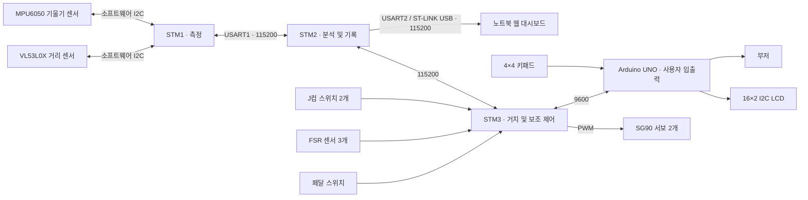
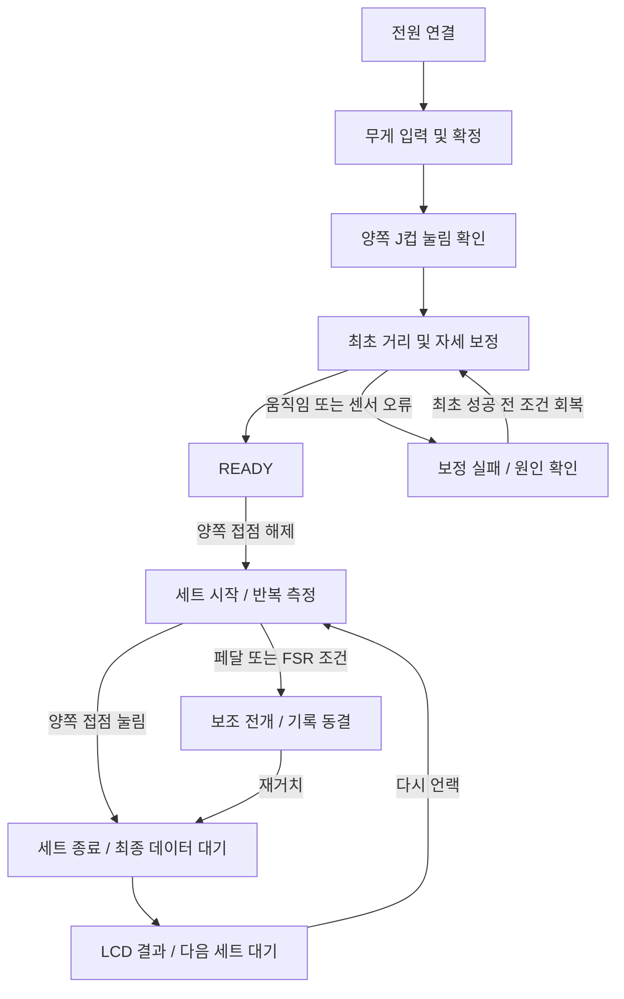

# Smart Bench

**STM32 3대와 Arduino UNO를 이용한 벤치프레스 운동 측정·보조 동작·세트 분석 프로젝트**

바벨의 거리 변화와 기울기를 측정하고, J컵 스위치로 세트의 시작과 종료를 판단한다. 페달과 FSR 입력은 보조 서보 동작에 사용하며, 세트별 측정 결과와 다음 세트 추천을 LCD에 표시한다. STM2에는 운동 기록을 USB 시리얼로 내보내는 기능이, 노트북에는 이를 표시하는 로컬 웹 대시보드가 구현되어 있다.

기본 사용 규칙은 **무게 입력 → 거치 상태에서 최초 보정 → 뽑으면 세트 시작 → 놓으면 세트 종료 → 최초 보정값으로 다음 세트 진행**이다. 사용자가 바를 든 상태에서 별도로 보정을 기다리지 않도록 설계했다.

> 이 프로젝트의 서보 보조 장치는 SG90을 사용하는 **모형 시연용**이다. 실제 운동 중량을 지지하는 장치의 강도·응답 시간·안전성을 검증한 제품은 아니다.

## 목차

- [현재 소스 기준과 통합 상태](#현재-소스-기준과-통합-상태)
- [시스템 구성](#시스템-구성)
- [저장소 구조](#저장소-구조)
- [하드웨어와 배선](#하드웨어와-배선)
- [개발 환경과 시스템 설정](#개발-환경과-시스템-설정)
- [빌드 및 업로드](#빌드-및-업로드)
- [사용 방법과 상태 흐름](#사용-방법과-상태-흐름)
- [측정과 세트 분석](#측정과-세트-분석)
- [통신 프로토콜](#통신-프로토콜)
- [웹 대시보드](#웹-대시보드)
- [구현의 어려움과 해결 과정](#구현의-어려움과-해결-과정)
- [트러블슈팅](#트러블슈팅)
- [확인 절차와 구현 범위](#확인-절차와-구현-범위)
- [GitHub에 포함할 파일](#github에-포함할-파일)
- [참고 자료](#참고-자료)

## 현재 소스 기준과 통합 상태

이 문서는 **2026-11-21의 저장소 소스**를 기준으로 작성했다. 보드 동작은 각 프로젝트의 `Core/Src/main.c`를 기준으로 설명하며, `stm3_test/`는 ADC의 DMA/Polling 비교 실험 자료로 구분한다.

| 구분 | 현재 소스에서 확인한 내용 |
| --- | --- |
| 본 구현 | `stm1/`, `stm2/`, `stm3/`, `uno/` |
| 비교 실험 | `stm3_test/main.c`; 본 구현을 대체하는 업로드 대상으로 사용하지 않음 |
| STM3 ADC 방식 | 본 구현에도 비교 계측 코드가 포함되어 있으며, 현재 `TEST_ADC_DMA=0`으로 **Polling** 사용. `1`이면 DMA 경로 선택 |
| 최초 보정 | 거치 상태에서 성공한 보정값을 전원 주기 동안 재사용 |
| D 키와 웹 | UNO의 D 요청, STM2의 종료·저장·전송, 웹 수신 구현은 존재하지만 **현재 STM3에는 D 요청/완료 응답 중계가 빠져 있음** |
| 클록 설정 | 실행 중에는 `main.c`가 **HSI 8 MHz**로 설정. `.ioc`에 남아 있는 64 MHz 설정과 다름 |

**D 키 웹 연동의 현재 제한:** UNO는 `T_KEY.c=1`로 종료를 요청하고, STM2는 `T_RACK.a`의 `F_SESSION_END`를 기다린다. 그러나 현재 STM3는 `T_KEY`에서 무게만 처리하며, 이 플래그를 STM2로 보내거나 완료 응답을 UNO로 전달하지 않는다. 따라서 현재 네 보드 소스를 그대로 업로드하면 D 키만으로 웹 리포트를 완료하는 경로가 이어지지 않는다. 아래 D 키 설명은 이 중계가 연결된 통합 동작을 설명하며, 현재 빠진 구간은 [트러블슈팅](#트러블슈팅)에 명시했다.

## 시스템 구성



| 보드 | 담당 역할 | 주요 구현 |
| --- | --- | --- |
| STM1 | 운동 측정 | ToF·IMU 초기화, 최초 보정, 거리 필터링, 반복 카운트, 상승 시간·기울기 측정, ToF 복구 |
| STM2 | 데이터 집계·분석 | 세트 ID 기반 누적값 처리, 최종 데이터 대기, 오류 기록, 규칙 기반 추천, 운동별 결과 보관, USB JSON 출력 |
| STM3 | 물리 상태와 보조 동작 | 거치/언랙 판정, 무게 등록, FSR·페달 감시, 서보 제어, STM2와 UNO 사이 LCD·키 입력 중계 |
| UNO | 사용자 인터페이스 | 무게 입력, D 키 요청, LCD 상태/결과 표시, 부저 알림 |
| 노트북 | 완료 운동 시각화 | USB 시리얼 수신, 세트별 결과·합계·그래프 표시, JSON 저장 |

보조 동작은 STM3에서 직접 판단한다. 웹은 결과를 읽어 표시하며 모터나 세트 시작을 제어하지 않는다.

## 저장소 구조

```text
smart-bench/
├─ README.md
├─ stm1/                     # 측정 보드 CubeIDE 프로젝트
│  ├─ Core/Src/main.c
│  ├─ Core/Inc/, Core/Startup/, Drivers/
│  ├─ .project, .cproject
│  ├─ stm1.ioc
│  └─ STM32F103RBTX_FLASH.ld
├─ stm2/                     # 분석·기록 보드 CubeIDE 프로젝트
│  └─ Core/Src/main.c
├─ stm3/                     # 거치·FSR·서보 보드 CubeIDE 프로젝트
│  └─ Core/Src/main.c
├─ stm3_test/
│  └─ main.c                # ADC DMA/Polling 비교 실험 자료
├─ uno/
│  └─ uno.ino               # Arduino UNO 스케치
└─ demo-web/
   ├─ README.md             # 웹 실행 안내
   ├─ start.cmd             # Windows 실행 파일
   ├─ serve.py              # Python 표준 라이브러리 HTTP 서버
   └─ dist/
      ├─ index.html
      ├─ style.css
      ├─ app.js             # USB 연결·리포트 표시·파일 저장
      └─ protocol.js        # 분할 수신 및 완전한 리포트 검증
```

STM2·STM3도 STM1과 같은 형태의 CubeIDE 프로젝트 파일, 시작 코드, 드라이버, 링커 스크립트를 포함한다. 주요 동작은 [STM1](stm1/Core/Src/main.c), [STM2](stm2/Core/Src/main.c), [STM3](stm3/Core/Src/main.c), [UNO](uno/uno.ino)에서 확인할 수 있다.

## 하드웨어와 배선

### 구성 부품

| 부품 | 수량 | 용도 |
| --- | ---: | --- |
| NUCLEO-F103RB / STM32F103RB | 3 | 측정, 분석, 보조 제어 분담 |
| Arduino UNO R3 / ATmega328P | 1 | 키패드·LCD·부저 |
| VL53L0X 모듈 | 1 | 바의 거리 변화 측정 |
| MPU6050 모듈 | 1 | 기준 자세 대비 기울기 측정 |
| FSR 압력 센서 및 분압 회로 | 3 | 보조 동작 입력 |
| J컵 접점 스위치 | 2 | 좌우 거치 확인 |
| 페달 접점 스위치 | 1 | 수동 보조 요청 |
| SG90 서보 | 2 | 모형 보조 기구 전개·수납 |
| 4×4 매트릭스 키패드 | 1 | 무게 입력·운동 종료 요청 |
| 16×2 LCD + PCF8574 I2C 백팩 | 1 | 상태·세트 결과 표시 |
| 부저 또는 부저 구동 모듈 | 1 | 상태 알림 |
| USB 데이터 케이블·전원·공통 GND 배선 | 구성에 맞게 | 보드 전원, 업로드, 웹 연결 |

아래 표는 **코드에서 확인한 신호 연결**이다. 센서 브레이크아웃의 전원 사양, FSR 저항값, 서보 전원 용량, 커넥터의 물리적 순서는 사용한 부품 및 실제 회로와 함께 확인해야 한다.

### 보드 사이 UART

UART는 **TX → 상대 RX**, **RX ← 상대 TX**로 교차 연결하고 GND를 공유한다.

| 송신 핀 | 수신 핀 | 속도 | 데이터 |
| --- | --- | --- | --- |
| STM1 PA9 / USART1 TX | STM2 PA10 / USART1 RX | 115200, 8N1 | 측정·보정 상태 |
| STM2 PA9 / USART1 TX | STM1 PA10 / USART1 RX | 115200, 8N1 | 세트 제어·보정 토큰 |
| STM2 PB10 / USART3 TX | STM3 PA10 / USART1 RX | 115200, 8N1 | LCD용 결과·보정 상태 |
| STM3 PA9 / USART1 TX | STM2 PB11 / USART3 RX | 115200, 8N1 | 거치·세트·보조 상태 |
| STM3 PB10 / USART3 TX | UNO D10 / 소프트웨어 RX | 9600, 8N1 | LCD 상태 프레임 |
| UNO D11 / 소프트웨어 TX | STM3 PB11 / USART3 RX | 9600, 8N1 | 무게 입력 ACK용 번호·D 요청 |

STM32와 UNO 사이에는 **3.3 V/5 V 로직 전압 차이**가 있다. 사용 핀의 허용 입력 전압과 수신 임계값을 확인하고 UART용 레벨 변환 회로를 구성한다. FSR의 아날로그 입력에 5 V를 넣어서는 안 된다.

### STM1: 센서 연결

| STM1 핀 | 연결 | 비고 |
| --- | --- | --- |
| PB6 | VL53L0X SCL + MPU6050 SCL | 소프트웨어 I2C, 오픈 드레인 |
| PB7 | VL53L0X SDA + MPU6050 SDA | 두 센서가 버스 공유 |
| GND | 두 모듈 GND | 공통 접지 |
| PB0 | VL53L0X XSHUT, 선택 사항 | 현재 `TOF_USE_XSHUT=0`이므로 사용하지 않음 |

- VL53L0X 주소는 `0x29`, MPU6050 주소는 `0x68`이다. MPU6050의 AD0 설정을 확인한다.
- SCL/SDA는 STM32와 호환되는 **3.3 V 논리 레벨로 풀업**한다. 모듈에 이미 있는 풀업과 전압 변환 회로를 함께 확인한다.
- MPU6050은 코드의 보정 조건에 맞게 **+X축이 아래 방향, Y축이 수평**이 되도록 고정한다. 모듈 장착 방향이 다르면 안정적으로 놓아도 보정이 실패할 수 있다.
- ToF는 하강 때 측정 거리가 작아지고 복귀 때 커지는 배치여야 한다. 센서를 움직이거나 반사면이 바뀌면 동일한 임계값으로 같은 동작을 판정하기 어렵다.
- 보정 후 센서 위치나 거치 높이를 바꿨다면 전원을 다시 시작하고 새 기준으로 보정한다.

### STM3: 접점·FSR·서보

| STM3 핀 | 기능 | 연결/설정 |
| --- | --- | --- |
| PC8 | 왼쪽 J컵 스위치 | 내부 풀업, 눌리면 GND로 연결 |
| PC9 | 오른쪽 J컵 스위치 | 내부 풀업, 눌리면 GND로 연결 |
| PC7 / D9 | 페달 | 내부 풀업, 누르면 GND로 연결 |
| PA0 / A0 | FSR 1 | ADC1 채널 0, 분압 출력 |
| PA1 / A1 | FSR 2 | ADC1 채널 1, 분압 출력 |
| PA4 / A2 | FSR 3 | ADC1 채널 4, 분압 출력 |
| **PA7 / D11** | **서보 1 신호** | TIM3 CH2, 전개 1500 µs / 수납 2500 µs |
| **PA6 / D12** | **서보 2 신호** | TIM3 CH1, 전개 1500 µs / 수납 500 µs |

NUCLEO의 `D11/D12` 표기는 UNO의 동일 번호 핀과 별개의 보드 핀이다. NUCLEO 핀 대응은 [ST UM1724](https://www.st.com/resource/en/user_manual/um1724-.pdf)의 NUCLEO-F103RB 표를 기준으로 확인한다.

FSR은 누를수록 ADC값이 증가하도록 연결한다. 다음은 코드가 기대하는 방향의 분압 구성 예시이며, **고정 저항값은 저장소에 지정되어 있지 않다.**

```text
3.3 V ── FSR ──┬── ADC 입력(PA0 / PA1 / PA4)
               │
             고정 저항
               │
              GND
```

서보의 전원은 신호 핀과 구분한다. 모터에 필요한 전류를 공급할 수 있는 전원을 사용하고 STM3와 GND를 공유한다. 전개/수납 펄스는 현재 모형의 설정값이며, 부착 방향과 기구의 이동 범위를 확인한 뒤 사용한다.

현재 STM3에는 `TEST_TRACE=1`도 설정되어 있다. **PC0=ADC 취득 구간, PC1=요청 처리 구간, PC2=거치 처리 구간**을 계측용 출력으로 사용하므로 해당 핀에 다른 장치를 연결하지 않는다.

### Arduino UNO: 사용자 입출력

| UNO 핀 | 연결 |
| --- | --- |
| D2, D3, D4, D5 | 키패드 Row 1~4 |
| D6, D7, D8, D9 | 키패드 Column 1~4 |
| D10 | STM3에서 오는 소프트웨어 UART RX |
| D11 | STM3으로 보내는 소프트웨어 UART TX |
| D12 / PB4 | 부저 제어 출력, HIGH 시 활성 |
| A4 / SDA | LCD 백팩 SDA |
| A5 / SCL | LCD 백팩 SCL |
| D0/D1 | 하드웨어 UART·USB 진단, 보드 간 통신용으로 사용하지 않음 |

LCD는 `0x27`, `0x3F`를 먼저 확인하고, 필요하면 PCF8574 주소 범위를 탐색한다. 키패드 커넥터의 실제 행/열 순서는 제품마다 확인해야 한다. 부저는 ON/OFF 구동이므로 부저 종류에 맞는 구동 회로를 사용한다.

### 노트북 연결

웹 데이터는 **STM2의 ST-LINK USB 포트**로 연결한다. STM2의 USART2 TX(PA2)가 ST-LINK Virtual COM Port를 통해 노트북으로 전달되며 속도는 `115200 / 8N1`이다. USB 케이블은 데이터 전송을 지원해야 한다. 여러 ST-LINK가 연결되어 있다면 STM2의 COM 번호를 구분한다.

## 개발 환경과 시스템 설정

| 항목 | 설정 |
| --- | --- |
| STM MCU | STM32F103RB, Cortex-M3, Flash 128 KB / SRAM 20 KB |
| STM 실행 클록 | 내부 HSI 8 MHz, `main.c`에서 직접 초기화 |
| STM 프로젝트 | STM32CubeIDE, GCC, STM32Cube FW_F1 V1.8.7 기반 설정 파일 포함 |
| UNO | Arduino UNO R3, ATmega328P, 16 MHz |
| 제어 방식 | 핵심 주변장치 제어는 레지스터 직접 접근 |
| 웹 | HTML/CSS/JavaScript, 외부 프레임워크·CDN 의존 없음 |
| 웹 실행 서버 | Python 3 표준 라이브러리, localhost만 바인딩 |
| USB 웹 연결 | Web Serial을 지원하는 데스크톱 Chrome/Edge |

CubeIDE 프로젝트에는 CMSIS/HAL 드라이버와 생성된 시스템 파일이 포함되어 있다. **애플리케이션 제어를 레지스터로 구현했다는 의미이지 저장소 전체에서 HAL이나 Arduino 코어를 제거했다는 의미는 아니다.** UNO도 Arduino 스케치로 빌드하되 `Wire`, `SoftwareSerial`, `Servo` 라이브러리 없이 해당 기능을 직접 처리한다.

### 타이머와 DMA 분담

| 보드 | 자원 | 용도 |
| --- | --- | --- |
| STM1 | TIM2 / TIM3 | ms 시간 기준 / µs 지연 |
| STM1 | USART1 TX + DMA1 Channel 4 | STM2로 측정·보정 프레임 송신, 8슬롯 큐 |
| STM1 | USART1 RX IRQ | 2048바이트 수신 링 버퍼 |
| STM2 | TIM4 | ms 시간 기준 |
| STM2 | USART1 TX + DMA1 Channel 4 | STM1 제어 송신, 4슬롯 큐·전송 완료/시간 초과 관리 |
| STM2 | USART1/3 RX IRQ | 각 256바이트 수신 링 버퍼 |
| STM3 | TIM3 CH1/CH2 | 20 ms 주기의 서보 PWM |
| STM3 | TIM4 / TIM1 | ms 시간 기준 / ADC 비교용 µs 계측 |
| STM3 | ADC1, 선택적 DMA1 Channel 1 | FSR 3채널 취득; 현재 Polling 선택 |
| UNO | Timer1 CTC | 1 ms 시스템 틱, `OCR1A=249`, 16 MHz/64 |
| UNO | PCINT0 + Timer2 | D10 소프트웨어 UART 수신 |
| UNO | 하드웨어 TWI | LCD I2C 100 kHz |

UNO는 Timer0를 정지하고 인터럽트를 비활성화한다. 기본 `millis()`/`delay()` 동작을 전제로 기능을 추가하지 말고 현재 `sys_ms()`와 지연 함수를 확인한다.

### 주요 조정값

| 위치 | 설정 | 현재 값 / 의미 |
| --- | --- | --- |
| STM1 | `IMU_PERIOD_MS`, `IMU_CAL_N` | 20 ms, 100샘플; 최초 보정에 통상 약 2~3초 |
| STM1 | `RACK_CAL_TIMEOUT_MS` | 6000 ms |
| STM1 | `RACK_CAL_SPREAD_MM` | 보정 중 거리 최대–최소 45 mm 이하 |
| STM1 | `MIN_DROP_MM`, `RETURN_MM` | 하강 60 mm, 복귀 허용 30 mm |
| STM1 | `MIN_REP_MS`, `CONFIRM_SAMPLES` | 하강 확인 이후 복귀까지 최소 220 ms, 조건 연속 2샘플 |
| STM1 | `MIN_RANGE_MM`, `MAX_RANGE_MM` | 유효 거리 40~1600 mm; 보정 기준 거리는 100~1600 mm |
| STM1 | `MAX_GAP_MS`, `IMU_FRESH_MS` | 거리 유효 간격 350 ms, IMU 신선도 150 ms |
| STM1 | `TOF_RETRY_MS`, `TOF_STALL_MS` | 비활성 상태 복구 재시도 간격 2000 ms, 새 결과 정지 판정 1200 ms |
| STM1 | `TOF_USE_XSHUT` | 0; 현재는 I2C 소프트웨어 리셋 경로 |
| STM3 | `FSR1/2/3_THRESHOLD` | 각각 ADC 원시값 2000; 힘/질량 단위가 아님 |
| STM3 | `FSR_CONFIRM_MS` | 임계값 초과가 연속 3000 ms 유지될 때 보조 요청 |
| STM3 | `FSR_RELEASE_MARGIN` | 100; 수납 허용 조건은 각 값이 1900 미만 |
| STM3 | `SERVO_STEP_US`, `SERVO_STEP_MS` | 20 ms마다 25 µs 변경; 명령값 1000 µs 이동에 약 0.8초 |
| STM3 | `SERVO_ENABLED`, `FSR_CALIBRATED` | 모두 1; 소프트웨어 활성 설정이며 실제 교정 완료를 자동 증명하지 않음 |
| STM3 | `TEST_ADC_DMA`, `TEST_ADC_PERIOD_MS` | 0=Polling, 1=DMA / 목표 요청 간격 5 ms |
| STM2 | `REP_LOG_N`, `SESSION_SET_N` | 현재 세트 반복 로그 256개, 운동별 첫 32세트 요약 |

## 빌드 및 업로드

### STM32

1. STM32CubeIDE에서 `stm1`, `stm2`, `stm3` 폴더를 각각 기존 프로젝트로 가져온다. 프로젝트 이름도 각각 구분한다.
2. 대상 MCU가 `STM32F103RBTx`, 링커 스크립트가 `STM32F103RBTX_FLASH.ld`인지 확인한다.
3. 각 보드의 `Core/Src/main.c`를 확인하고 프로젝트를 빌드한다.
4. 해당 보드의 ST-LINK를 선택하여 다운로드한다. 여러 보드가 연결되어 있다면 ST-LINK 식별자를 확인하거나 한 대씩 업로드한다.
5. 다운로드 후 실행을 재개한다. 디버거가 `main()`에서 정지한 상태이면 시스템은 아직 동작하지 않는다.

**`.ioc`에서 코드를 다시 생성하지 않고 현재 프로젝트를 빌드하는 것이 기준이다.** 현재 `.ioc`의 64 MHz PLL 설정은 `main.c`의 HSI 8 MHz 직접 초기화와 일치하지 않는다. 또한 사용자 코드가 모두 CubeMX의 보존 구역 안에 있는 구조가 아니므로 재생성으로 `main.c`를 덮어쓸 수 있다.

`main.c` 자체는 업로드용 바이너리가 아니다. 프로젝트 빌드로 생성한 ELF/HEX/BIN을 보드에 다운로드한다. VS Code에서 파일을 여는 것만으로 업로드되지는 않으며, 이 저장소의 STM 빌드 기준은 CubeIDE 프로젝트다.

### Arduino UNO

1. Arduino IDE에서 [uno/uno.ino](uno/uno.ino)를 연다.
2. 보드는 **Arduino Uno**, 대상은 **ATmega328P / 16 MHz**로 선택한다.
3. UNO의 COM 포트를 선택하고 검증 후 업로드한다.

다른 보드나 클록을 선택하면 스케치의 전처리 검사에서 오류가 발생할 수 있다. UNO의 USB 업로드 포트와 STM2 웹 연결 포트는 서로 다르다.

### 실행 전 확인

- 각 보드에 올바른 프로젝트를 업로드했는지 확인한다.
- UART 교차 연결, 공통 GND, 센서 방향, 스위치의 눌림 논리를 확인한다.
- 서보가 전개 상태로 시작하는지 모형에 부하를 걸기 전에 확인한다.
- 모든 보드를 함께 시작하고 무게 입력 및 최초 보정을 진행한다. 세트 ID와 보정 상태는 RAM에 있으므로 운동 중 한 보드만 리셋하면 보드 사이 상태가 달라질 수 있다.

## 사용 방법과 상태 흐름

### 키패드

```text
1  2  3  A
4  5  6  B
7  8  9  C
*  0  #  D
```

| 키 | 동작 |
| --- | --- |
| `0`~`9` | 무게 입력 |
| `A` | 소수점 입력 |
| `B` | 마지막 문자 삭제 |
| `*` | 입력 전체 지우기 |
| `#` | 무게 확정·전송 |
| `C` | 현재 기능 없음 |
| `D` | 거치 상태에서 전체 운동 종료 요청; 현재 STM3 중계 누락에 유의 |

입력 범위는 **0.1~999.9 kg**, 소수점은 한 자리이다. 예를 들어 `6 → 2 → A → 5 → #`는 62.5 kg이다. 운동 중에는 무게를 바꾸지 않으며, 다음 세트의 무게 변경은 비활성 상태에서 확정한다. 추천 무게가 자동으로 적용되는 구조는 아니다.

### 정상 세트 진행



1. 전원을 연결하면 먼저 무게를 입력한다. UNO는 STM3 화면을 받기 전에도 입력을 받고 전송을 대기할 수 있다.
2. 무게가 등록되고 양쪽 J컵이 눌리면 최초 보정을 요청한다. 바를 정지 상태로 유지한다.
3. `READY`가 확인되면 바를 든다. 최초 보정값으로 즉시 반복 측정을 시작하며, 언랙 후 추가 정지 보정은 없다.
4. 바를 놓으면 세트를 종료한다. STM2는 최종 측정 패킷을 기다리며, 최대 1.5초 안에 받지 못하면 `I_FINAL` 오류를 남긴다.
5. 다음 세트에서는 같은 보정값을 재사용한다. 정상적인 0회 세트는 불필요한 결과 순환 화면 대신 다음 세트 대기로 돌아간다.

스위치는 30 ms 디바운싱 후, 양쪽 눌림은 500 ms, 양쪽 해제는 100 ms의 상태 유지 조건으로 확정한다. 한쪽만 눌린 상태는 중간 상태로 취급한다. 따라서 ‘즉시 시작’은 **언랙 후 보정 대기가 없다는 뜻**이며 접점 확인·통신 지연까지 0이라는 뜻은 아니다.

첫 `READY` 전에 바를 들어도 STM3의 세트 ID가 증가할 수 있다. STM1/STM2는 보정 미완료를 오류로 처리하므로 첫 세트는 준비 완료를 확인한 후 시작한다. 이미 최초 보정이 성공한 뒤 기준이 무효화되는 센서 장애가 발생하면, 원인을 해결하고 재시작해야 한다. 센서 통신 복구와 보정 기준 재확정은 별개의 동작이다.

### 보조 동작

- 언랙/운동 상태에서 페달이 눌리거나, FSR 중 하나가 임계값을 연속 3초 초과하면 보조 동작을 요청한다.
- 운동 중 FSR 데이터가 유효하지 않아도 보조 전개를 요청할 수 있다.
- `hold` 상태로 래치하여 반복 개입을 막고, 재거치 때 래치를 해제한다.
- STM1/STM2는 보조 개입 후 반복 기록을 동결하고 보조 원인을 결과에 남긴다.
- 보조 요청 시 전개 목표는 바로 바뀌지만, 서보 명령은 전개·수납 모두 단계적으로 이동한다. 물리적으로 즉시 전개되는 것은 아니다.
- 수납은 FSR 데이터가 정상이고, 페달이 해제되어 있으며, 모든 FSR값이 해제 기준 미만일 때 허용한다.

## 측정과 세트 분석

### 거리와 기울기

ToF는 약 10 ms마다 새 결과를 확인한다. 실제 센서의 새 측정값 발생 주기와 폴링 주기는 구분한다. 거리 범위, 반사 신호, 드라이버 내부 원시 상태값을 확인하고 3샘플 중앙값 필터를 적용한다.

반복 카운트에는 **필터링한 ToF 거리값 자체**를 사용한다. MPU 값으로 거리를 투영 보정하거나 가속도를 적분하여 위치를 계산하지 않는다. MPU는 별도로 중력 방향과 자이로 바이어스를 보정하고 상보 필터로 기준 대비 기울기를 추정한다. 기울기 경고는 5° 이상에서 켜지고 4° 미만에서 해제된다.

반복 판정은 다음 순서로 진행한다.

1. 최초 기준 거리에서 60 mm 이상 작아진 값이 연속 확인되면 하강으로 판정한다.
2. 하강 중 최저 거리와 그 시각을 추적한다.
3. 기준 거리에서 30 mm 이내까지 복귀하고 최소 시간 조건을 만족하면 1회를 추가한다.
4. 마지막 최저점 갱신 시각부터 복귀까지를 상승 시간으로 기록한다.
5. 측정 간격이 끊기면 `ARM_TOP`으로 돌아가 상단 복귀를 확인한 후 다시 센다.

정상 세트 시작은 `WAIT_DOWN`에서 출발한다. `ARM_TOP`은 누락·거치 접촉 등으로 반복 판정이 중단된 뒤 기준 위치를 다시 확인하는 상태이다.

### STM2의 세트 집계

측정 프레임은 세트 ID와 누적 반복 수를 가진다. STM2는 같은 프레임을 다시 받았다고 반복 수를 더하지 않는다. 현재 세트의 무게, 반복 수, 상승 시간 합계, 첫 1~2회 시간 합계, 마지막 상승 시간, 최대 기울기, 오류와 보조 원인을 집계한다.

‘전체 운동’은 D로 완료하는 여러 세트의 묶음이고, ‘세트’는 한 번 언랙해서 다시 거치할 때까지이다. STM2의 세트 요약 저장 한도는 운동당 32개다. 초과한 개수는 별도로 기록한다. 현재 STM3의 D 중계가 없으면 전체 운동 완료 및 다음 운동으로 기록을 비우는 흐름도 연결되지 않는다.

### 불안정 점수와 다음 세트 추천

이 기능은 학습 모델이 아닌 **규칙 기반 계산**이다. 소스에 남아 있는 `AI` 또는 `vl_pct`라는 이름과 실제 계산의 의미를 구분한다.

```text
기준 상승 시간 = 첫 1~2회 상승 시간의 평균
상승 시간 증가율(%) = max(0, (마지막 상승 시간 - 기준 상승 시간) / 기준 상승 시간 × 100)
불안정 점수 = min(100, 증가율 × 1.2 + 최대 기울기(도) × 5)
보조 개입 시 점수 하한 = 80
```

실제 구현은 정수 연산이므로 나눗셈에서 소수 부분을 버린다. **상승 시간 증가율은 실제 속도 감소율과 다르다.** 반복마다 이동 거리가 같다는 보장도 없으므로 웹에서는 이 값을 ‘상승 시간 증가율’로 표시한다.

| 우선순위 | 조건 | 다음 무게 | 다음 반복 수 |
| --- | --- | --- | --- |
| 1 | 보조 개입 또는 기울기 ≥ 7° 또는 점수 ≥ 70 | 현재의 85%를 단위 보정 | 현재 횟수, 최소 5회 |
| 2 | 증가율 ≥ 30% 또는 기울기 ≥ 5° 또는 점수 ≥ 45 | 현재의 90%를 단위 보정 | 현재 횟수 |
| 3 | 증가율 < 15%, 기울기 < 3°, 8회 이상 | 현재 + 2.5 kg 후 단위 보정 | 현재 − 2회 |
| 4 | 그 외 분석 가능 상태 | 현재 유지 | 5회 초과면 1회 감소, 그 외 유지 |

무게 단위 보정은 2.5 kg 단위 반올림과 20 kg 하한을 적용한다. 따라서 20 kg 미만 입력에서 ‘감량’ 분기를 타더라도 실제 추천값이 입력보다 작지 않을 수 있다. 무게 입력 허용 범위와 이 추천 알고리즘의 하한은 다르다.

보조가 없는 세트는 3회 미만, 오류 발생, 기준 상승 시간 없음 등의 경우 추천을 보류한다. 보조 개입은 별도 감량 분기이며, 표현 가능한 추천 범위를 초과하면 `REC_NONE`으로 처리한다. 추천값은 자동으로 무게 설정을 바꾸지 않는다.

## 통신 프로토콜

### 보드 간 바이너리 프레임

모든 보드가 같은 **37바이트 고정 프레임**을 사용한다.

| 바이트 위치 | 길이 | 내용 |
| --- | ---: | --- |
| 0~1 | 2 | 시작 헤더 `0xA5 0x5A` |
| 2 | 1 | 패킷 종류 `type` |
| 3~6 | 4 | 세트 ID `id`, little-endian |
| 7~34 | 28 | `a`~`g`, 각각 little-endian 32비트 |
| 35~36 | 2 | CRC16, little-endian |

CRC는 다항식 `0x1021`, 초기값 `0xFFFF`로 `type`부터 `g`까지 33바이트를 계산한다. 프레임 크기나 필드 해석을 바꾸면 송신·수신 보드를 함께 수정해야 한다.

| 종류 | 값 | 경로 / 역할 |
| --- | ---: | --- |
| `T_RACK` | 1 | STM3 → STM2, 거치·활성·보조·FSR·보정 토큰 |
| `T_CONTROL` | 2 | STM2 → STM1, 측정 제어·보정 토큰 |
| `T_MEASURE` | 3 | STM1 → STM2, 누적 반복·시간·기울기·최종 상태 |
| `T_UI` | 4 | STM2 → STM3 → UNO, LCD 표시 데이터 |
| `T_KEY` | 5 | UNO → STM3, 무게·입력 순번·D 요청 |
| `T_CAL_STATUS` | 6 | STM1 → STM2 → STM3, 보정 토큰·상태·기준 거리 |

대표 단위는 **무게 0.1 kg, 기울기 0.1°, 시간 ms, 거리 mm**이다. `T_UI`는 일반 화면과 결과 화면의 필드 배치가 다르다.

- 일반 화면: `f` 하위 16비트는 기울기, 상위 16비트는 STM2→STM3에서 보정 토큰이고 STM3→UNO에서 키 입력 ACK로 바뀐다. `g` 상위 16비트는 오류다.
- 결과 화면: `a[29:20]`에 10비트 오류를, `f`에 기울기·점수·다음 반복 수를, `g`에 추천 코드·보조 원인·정확한 다음 무게를 담는다.
- 전체 운동 종료는 `a`의 **bit 30 `F_SESSION_END`**를 요청/완료 응답으로 사용하는 구조다. 현재 STM3가 이 부분을 전달하지 않는다.

### 오류 비트

LCD의 `ERR`는 여러 조건을 OR한 16진수 비트마스크다.

| 값 | 이름 | 의미 |
| --- | --- | --- |
| `0x001` | `I_WEIGHT` | 무게 정보 문제 |
| `0x002` | `I_IMU` | IMU/자세 기준 유효성 문제 |
| `0x004` | `I_MODEL` | 보조 장치 설정 또는 시작 상태 문제 |
| `0x008` | `I_LINK` | 통신 누락·지연 |
| `0x010` | `I_FSR` | FSR 데이터/수납 조건 문제 |
| `0x020` | `I_FINAL` | 최종 데이터 미수신 또는 기록 한도 관련 문제 |
| `0x040` | `I_DISTANCE` | 거리 데이터 문제 |
| `0x080` | `I_ASSIST` | 보조 개입 |
| `0x100` | `I_BASE` | 세트 기준 거리 미확립 |
| `0x200` | `I_CAL` | 최초 보정이 준비되지 않은 상태에서 시작 |

## 웹 대시보드

### 실행

Windows에서 [demo-web/start.cmd](demo-web/start.cmd)를 더블클릭하거나 저장소 루트에서 실행한다.

```powershell
.\demo-web\start.cmd
```

Python을 직접 실행해도 된다.

```powershell
python .\demo-web\serve.py
```

1. Python 3가 필요하다. `pip` 패키지나 npm 설치는 필요 없다.
2. 실행 창에 표시되는 `http://localhost:<자동 할당 포트>`를 Chrome/Edge에서 연다. 기본 브라우저가 다르면 주소를 복사한다.
3. 서버 창을 열어 둔 상태에서 **STM2 연결**을 누르고 STM2의 ST-LINK VCP를 선택한다.
4. 같은 COM 포트를 사용하는 시리얼 모니터는 닫는다.

Web Serial은 사용자 동작으로 포트 선택 권한을 요청한다. 따라서 페이지를 열어 두기만 하는 것으로 연결이 끝나지는 않는다. 구현 기준은 [Chrome Web Serial 공식 문서](https://developer.chrome.com/docs/capabilities/serial/)를 참고한다.

### 완료 운동의 전달 구조

중계가 연결된 구성에서의 흐름은 다음과 같다.

```text
바 거치 → 키패드 D → UNO 종료 요청
→ STM3가 요청을 랙 프레임에 반영 [현재 소스에서 누락]
→ STM2가 최종 세트 데이터 확정 및 운동 결과 복사
→ USART2 / ST-LINK USB → 웹 리포트 표시
→ STM2 완료 상태 → STM3 → UNO LCD [STM3 응답 중계도 누락]
```

D는 **4×4 키패드 오른쪽 맨 아래 키**이며 노트북의 D 키가 아니다. UNO는 활성 세트, 거치 미확인, 무게 입력 중 등의 상태에서는 종료 요청을 보내지 않는다. 중계가 연결되면 `Finishing...` 후 `Workout ended / See laptop / USB`를 표시한다. LCD의 완료는 STM2의 처리 완료를 의미하며 브라우저 수신 ACK는 아니다.

### 화면과 데이터

- 기록된 세트 수, 총 반복 수, 총 운동량(`kg × 횟수`), 보조 개입 세트 수
- 세트별 무게·횟수·평균/마지막 상승 시간·최대 기울기
- 상승 시간 증가율, 불안정 점수, 다음 무게/횟수 추천
- 측정 오류·보조 원인·추천 보류 표시
- 세트별 반복 그래프와 결과 JSON 다운로드

STM2는 진단 로그와 함께 `@BENCH `로 시작하는 JSON 행을 보낸다. 한 리포트는 `begin → set 여러 개 → end`로 구성되며 `session`, `cycle`, 순번, 개수가 일치해야 화면에 반영한다. 누락되거나 잘린 수신은 다음 재전송으로 복구한다.

마지막으로 완료된 운동은 STM2 RAM에 별도로 유지되어 송신 묶음 종료 후 약 3초 간격으로 재전송된다. **운동 완료가 STM2까지 전달된 경우** 나중에 웹을 연결해도 결과를 받을 수 있다. 전원을 끄면 기록은 사라지며, 웹의 ‘결과 저장’은 노트북에 JSON을 내려받는다. 실시간 반복별 원시 파형 저장이나 클라우드 동기화는 구현 범위에 포함하지 않는다.

## 구현의 어려움과 해결 과정

아래 내용은 개발 과정에서 작성한 **첨부 PDF 3쪽의 문제 해결 기록**을 현재 소스와 대조해 정리했다. PDF 안의 과거 코드명이나 구현 설명보다 현재 함수와 설정을 우선한다. PDF 원본은 저장소에 포함되어 있지 않다.

### 1. 레지스터 직접 제어와 타이머 충돌

**문제:** 서로 다른 MCU에서 클록, GPIO, UART, 타이머, 인터럽트를 직접 설정해야 했다. UNO에서는 Arduino 코어가 사용하는 Timer0와 사용자 시간 기준이 충돌할 수 있었다.

**해결:** STM32는 `platform_init()`, `base_init()`, `uart_init()`에서 클록과 주변장치를 초기화했다. UNO는 Timer0를 비활성화하고 Timer1의 1 ms 틱을 사용했다. LCD는 하드웨어 TWI를 직접 제어하고 `line()`의 문자 캐시로 변경된 부분만 갱신한다.

**현재 확인 위치:** [STM1 초기화](stm1/Core/Src/main.c), [UNO의 timer1_init / twi_init / line](uno/uno.ino). HAL 생성 파일과 Arduino 빌드 코어는 프로젝트 안에 남아 있다.

### 2. UART 병목과 소프트웨어 UART 송신 중 시간 누락

**문제:** STM1의 폴링 송신은 센서 처리 주기를 지연시켰다. 9600 bps에서 37바이트 프레임은 전송에 약 39 ms가 필요하며, UNO가 이 구간에 인터럽트를 막으면 ms 틱이 누락될 수 있었다.

**해결:** STM1 송신에 DMA1 Channel 4와 8슬롯 큐를 적용하고 RX 링 버퍼를 2048바이트로 구성했다. STM2도 USART1 TX DMA 큐를 사용하며 DMA 완료와 UART의 마지막 비트 전송 완료를 구분한다. STM3는 UNO 송신을 `uno_tx_service()`로 나누어 한 번에 가능한 한 바이트를 보낸다. UNO는 송신 중 Timer1 비교 플래그를 확인해 ms 틱을 보완하고, PCINT0·Timer2로 수신 비트를 샘플링한다.

**관찰 지표:** `FE`, `NE`, `ORE`, 수신 overflow, CRC 오류, 큐 누락 및 DMA 시간 초과. DMA 적용만으로 모든 통신 오류가 제거되었다고 판단하지 않고 이 지표를 함께 본다.

### 3. I2C 버스 고착과 ToF 런타임 복구

**문제:** 리셋이나 통신 중단으로 SDA가 LOW에 머무르거나 ToF 새 결과가 멈추는 경우, 재초기화만 오래 수행하면 세트 제어 패킷까지 놓칠 수 있었다.

**해결:** STM1의 `recover_bus()`가 SCL을 최대 9회 구동하고 STOP 조건을 만들어 복구를 시도한다. 이후 `tof_reset_device()`와 `tof_init()`을 수행한다. 현재는 `TOF_USE_XSHUT=0`이므로 코드에 구현된 I2C 리셋 경로를 사용하며 응답 확인 결과를 로그로 남긴다.

복구 중에도 `service_recovery_link()`로 제어 수신과 상태 보고를 계속 수행한다. 운동 시작이나 제어 링크 이상을 확인하면 `recovery_interrupted()`로 복구 절차를 중단한다. 각 I2C 동작과 대기는 시간 제한 및 확인 지점 단위로 처리하므로 ‘완전히 무지연인 복구’라는 의미는 아니다.

**현재 제한:** 센서 통신이 살아나도 이미 확정했던 최초 보정이 무효화된 경우 자동으로 새로운 운동 기준을 만들지는 않는다. 최초 보정 성공 후의 기준 무효화는 원인 해결 및 재시작이 필요하다.

### 4. 보정 상태 동기화와 반복 오카운트

**문제:** 바를 든 뒤 보정을 기다리는 흐름은 사용 동작과 맞지 않았고, 보정 진행·완료 상태가 보드 사이에서 다르면 `Calibrating...`에 머물 수 있었다. 거리값 튐과 세트 경계에서의 접촉도 반복 판정에 영향을 주었다.

**해결:** `cal_token`과 `T_CAL_STATUS`로 같은 보정 요청의 상태를 추적한다. 보정은 J컵에 안정적으로 놓인 상태에서 거리·자세 기준을 함께 확정하고, `cal_completed_once`로 이후 세트에서 재사용한다. 결과 화면이 필드를 재사용하더라도 보정 상태는 별도 패킷으로 STM3에 전달한다.

거리값에는 범위·반사 신호 확인과 중앙값 필터를 적용했다. 하강/복귀에 서로 다른 거리 기준과 연속 샘플 조건을 사용하고, 유효 측정이 끊기면 상단 위치를 다시 확인한다. 기울기는 반복 거리와 별도로 계산한다.

### 5. 서보의 급격한 동작과 보조 상태 유지

**문제:** 목표 PWM을 한 번에 바꾸면 모형 기구가 급격히 움직이고 전원·기구에 부담이 생길 수 있었다. 입력이 반복되는 동안 보조 상태가 흔들리지 않도록 유지할 필요도 있었다.

**해결:** `assist()`에서 보조 상태를 래치하고 재거치 때 해제한다. `servo_set()`은 목표를 설정하고 `servo_move_task()`가 20 ms마다 25 µs씩 접근한다. 루프가 지연되어도 한 번에 따라잡는 큰 점프를 하지 않는다.

**PDF와 현재 설정의 차이:** PDF는 FSR의 DMA 취득을 설명하지만, 현재 본 STM3 파일은 `TEST_ADC_DMA=0`으로 Polling을 선택하고 있다. 양쪽 취득 경로가 존재하므로 현재 방식은 매크로와 실제 빌드 설정으로 구분한다. 약 0.8초는 명령값 이동의 계산값이며 서보축의 실측 도달 시간은 아니다.

### 6. 사용자 흐름과 결과 표현 정리

**문제:** 전원 연결 순서에 따라 무게 입력보다 거치 안내가 먼저 나오거나, 반복하지 않은 세트에서 보정/결과 화면이 반복되어 다음 동작을 알기 어려웠다. 보드 간 필드 해석이 다르면 소수점 무게와 오류 정보도 어긋날 수 있었다.

**해결:** 무게 미등록 안내를 우선하고, 최초 보정 이후 세트별 재보정을 없앴다. 정상 0회 세트는 바로 다음 대기로 돌아가며, 기록 부족과 센서 오류를 구분해서 추천을 보류한다. 무게는 전체 구간에서 0.1 kg 단위를 유지하고 결과용 오류·추천 필드를 별도로 정의했다.

### 7. 웹으로 넘기는 운동 단위 결과

**문제:** 마지막 세트 데이터가 도착하기 전에 운동을 닫거나 시리얼 데이터를 일부만 받으면 불완전한 결과를 표시할 수 있었다.

**해결:** STM2는 최종 세트 확정 후 운동 결과를 별도 버퍼에 복사하고 재전송하도록 구현했다. 웹은 begin/set/end 묶음의 번호와 개수가 맞을 때만 리포트를 표시하고 동일 결과의 반복 수신은 중복 표시하지 않는다.

**현재 통합 확인 사항:** 위 처리를 시작하는 UNO→STM3→STM2의 D 요청과 돌아오는 완료 응답을 현재 STM3에 연결해야 한다. 웹 화면이나 STM2 코드의 존재만으로 네 보드 전체 경로가 완성됐다고 판단하지 않는다.

## 트러블슈팅

| 증상 | 확인할 내용과 대응 |
| --- | --- |
| 무게를 입력하지 않았는데 `Rack bar first`가 먼저 보임 | 최신 UNO 스케치인지 확인. 무게 미등록 화면을 우선하는 `render()`와 무게 ACK 상태를 확인 |
| `Weight queued` / `Waiting STM3 ACK` | STM3 전원, D10/D11↔PB10/PB11 교차 배선, 9600 bps, 키 입력 순번 ACK 확인 |
| `Wait sensor link` | 실제 보정 진행과 다름. STM1→STM2→STM3 통신, 최근 `T_CAL_STATUS`, 토큰·세트 ID 일치 확인 |
| `Calibrating...`가 계속됨 | 양쪽 J컵과 접지, MPU 장착 방향, 센서 정지 상태, 거리 범위/반사면 확인. STM1 `[보정 실패]`, STM2 `[CALDBG]`의 토큰·링크·원인을 함께 확인 |
| 보정 완료 전에 들었더니 0회/오류 | 첫 READY 전에 시작한 세트인지 확인. 이번 세트는 측정 보류될 수 있음. 재거치 후 최초 보정 완료 확인 |
| 매 세트 보정하는 것처럼 보임 | 구버전 펌웨어 혼용, 한 보드만 재부팅, 최초 보정 자체의 실패 재시도 여부 확인 |
| 반복 횟수가 증가하지 않음 | 거리 하강 방향, 60 mm 하강과 30 mm 복귀 조건, 220 ms 최소 시간, 연속 샘플, `I_CAL`·`I_DISTANCE`·보조 개입 여부 확인 |
| 반복 없이 거치했을 때 결과가 없음 | 오류 없는 0회 세트는 다음 세트 대기로 돌아가는 것이 정상. 웹에서는 완료 운동에 포함된 0회 세트를 표시할 수 있음 |
| `Advice needs 3R` / `분석 보류` | 보조 없는 세트가 3회 미만이거나 기준 시간/센서 상태가 유효하지 않은지 확인 |
| ToF 값이 멈추거나 I2C 오류가 반복됨 | PB6/PB7, 3.3 V 풀업, 공통 GND, 모듈 전원과 반사면 확인. STM1 `[ToF RECOVERY]`, 초기화 단계/레지스터 로그 확인 |
| ToF가 복구됐지만 READY가 돌아오지 않음 | 최초 보정 성공 후 기준이 무효화되었는지 확인. 통신 복구와 재보정은 별개이므로 원인 해결 후 전체 상태를 재시작 |
| `LINK LOST / WAIT`, CRC/FE/NE/ORE 증가 | TX/RX 교차, GND, 로직 레벨, baud rate, 전원 변동, 다른 보드 코드 버전 확인. 연결된 디버거가 특정 보드를 정지시켰는지도 확인 |
| FSR을 눌러도 보조가 안 됨 | 누를수록 ADC값이 커지는 분압인지, 원시값 2000 초과가 연속 3초인지, 언랙/운동 감시 상태인지 확인 |
| 시작할 때 서보가 접히지 않음 | 페달 해제, FSR 세 값 모두 1900 미만, 50 ms 이내의 유효 FSR, 설정 및 전원 확인. 인터록에 의한 수납 차단일 수 있음 |
| 서보 방향이 반대이거나 한 개만 움직임 | PA7=서보 1, PA6=서보 2와 기구 부착 방향 확인. 두 서보 수납 목표가 각각 2500/500 µs로 반대임 |
| STM3 로그가 잠시 안 나옴 | 현재 본 코드에도 `TEST_QUIET=1`이 있음. 부팅 후 약 2초 준비 뒤 10초 계측 중 진단 로그를 억제하고, 이후 `[AB]` 결과 출력 |
| D를 눌러도 `Finishing...`에서 멈춤 | **현재 STM3의 종료 중계 누락을 먼저 확인.** `T_KEY.c`, 랙 프레임의 `F_SESSION_END`, STM2의 완료 플래그를 UNO로 전달하는 `send_ui()` 경로가 필요함 |
| 웹에서 포트를 열 수 없음 | STM2 ST-LINK VCP인지, 다른 시리얼 모니터가 점유 중인지, 데이터 케이블인지 확인 |
| 웹은 연결됐지만 리포트가 안 나옴 | 포트 연결과 운동 완료 데이터 수신은 별개. 현재 STM3의 D 중계 상태와 STM2 `@BENCH` 출력을 먼저 확인 |
| `start.cmd` 실행 실패 | Python 3 설치 및 `py -3 --version` 또는 `python --version` 확인. 서버 창을 닫지 않았는지 확인 |
| CubeMX 재생성 후 UART/PWM이 달라짐 | `.ioc`와 실제 `main.c`의 클록·주변장치 설정 차이 확인. 레지스터 초기화 코드와 덮어쓴 소스 복원 여부 확인 |

### 로그를 읽는 위치

- **STM1 USB/VCP, 115200:** `[측정]`, `[MPU]`, `[보정 실패]`, `[ToF RECOVERY]`, UART 진단.
- **STM2 USB/VCP, 115200:** `[CALDBG]`, `[UART1 STM1]`, `[UART3 STM3]`, `[CTRL]`, `[U1 DMA TX]`, 운동 완료 시 `@BENCH`.
- **STM3 USB/VCP, 115200:** 거치/언랙, FSR 원시값, PWM 명령, `[AB]` 비교 실험 로그.
- **UNO USB, 115200:** 시작 및 LCD 탐색 진단. STM3와의 실제 보드 간 통신은 별도 9600 bps 소프트웨어 UART다.

웹을 사용할 때는 STM2 COM 포트의 시리얼 모니터를 닫는다. 다른 보드의 진단 포트는 구분하여 사용한다.

## 확인 절차와 구현 범위

다음은 시연 전 확인할 절차이며, 이 문서 작성으로 새 실기 시험 결과를 확정한 것은 아니다.

| 확인 항목 | 기대 결과 |
| --- | --- |
| 무게 등록 | 거치 여부와 무관하게 입력 가능, ACK 후 확정 |
| 최초 보정 | 거치·정지 상태에서 READY, 최초 성공 후 다음 세트에서 재사용 |
| 언랙/거치 반복 | 새로운 세트 ID, 반복 기록 분리, 거치 후 최종 데이터 확정 |
| 0회 세트 | 정상일 때 다음 세트 대기로 복귀, 재보정 반복 없음 |
| 페달·FSR 보조 | 원인 기록, 서보 전개 목표 설정, 기록 동결, 재거치 후 래치 해제 |
| 센서/통신 누락 | 이전 정상값을 새 정상 측정처럼 취급하지 않고 오류 표시 |
| D 종료 및 웹 | STM3 중계 연결 후 완료 리포트 수신, 중복 수신 시 중복 생성 없음 |
| USB 재연결 | STM2에 완료 운동이 남아 있으면 재전송으로 수신 |
| 저장 한도 | 첫 32세트만 보관, 초과 세트 수 표시 |

`stm3_test/`는 ADC 비교용 자료다. 비교할 때는 나머지 조건을 유지하고 `TEST_ADC_DMA`만 바꾸어 요청 수·완료 수·소비 수·누락·최대 간격·오류를 비교한다. 현재 5 ms는 **목표 요청 간격**이며, `[AB_TIME_US]`는 요청 처리 구간의 경과시간이다. DMA 경로에서 줄어든 요청 처리시간을 곧바로 전체 CPU 사용률 감소나 전체 제어 지연 개선으로 해석하지 않는다. 저장소에 비교 실측 수치가 없어 성능 향상률을 제시하지 않는다.

현재 구현 범위는 모형의 측정·상태 제어·규칙 기반 분석이다. FSR값으로 실제 지지 하중을 계산하거나, 서보 위치를 피드백으로 확인하거나, 동작 오류를 독립된 안전 제어기로 차단하는 기능은 포함되어 있지 않다. 운동 기록은 RAM 기반이며 전원 차단 후 복원되지 않는다.

## GitHub에 포함할 파일

재현 가능한 프로젝트를 공유하려면 README와 `main.c`뿐 아니라 각 STM 프로젝트의 **`.project`, `.cproject`, `Core`, `Drivers`, 링커 스크립트, `.ioc`**를 함께 포함한다. `.ioc`의 현재 제한은 위 설명을 함께 유지한다.

UNO는 폴더명과 스케치명이 일치하는 `uno/uno.ino` 구조를 유지한다. 웹은 `demo-web/` 전체를 포함한다. 특히 **`demo-web/dist/`는 직접 작성한 실행 소스**이므로 일반적인 빌드 산출물로 보고 제외하지 않는다.

`Debug/`, `Release/`, 오브젝트·맵·자동 생성 바이너리, `__pycache__/`, IDE의 개인 작업 상태는 소스 재현에 필수적이지 않다. 바이너리를 배포할 경우에는 어느 소스와 설정으로 빌드했는지 구분한다. 포함된 ST·Arduino 관련 코드의 라이선스 표시는 유지하고, 프로젝트 전체에 적용할 라이선스는 배포자가 별도로 정한다.

## 참고 자료

- 프로젝트 소스: [STM1](stm1/Core/Src/main.c), [STM2](stm2/Core/Src/main.c), [STM3](stm3/Core/Src/main.c), [UNO](uno/uno.ino), [웹 수신](demo-web/dist/protocol.js), [웹 표시](demo-web/dist/app.js)
- 개발 과정 첨부 PDF: 구현의 어려움과 해결 과정, 3쪽. 레지스터 제어·UART·I2C 복구·보정·서보 개선의 이력 참고용이며 원본은 저장소 미포함.
- [ST UM1724 — STM32 Nucleo-64 boards](https://www.st.com/resource/en/user_manual/um1724-.pdf): NUCLEO-F103RB 커넥터·ST-LINK 연결 확인.
- [Chrome Web Serial 공식 문서](https://developer.chrome.com/docs/capabilities/serial/): 브라우저 포트 권한 요청과 시리얼 수신 구조.
